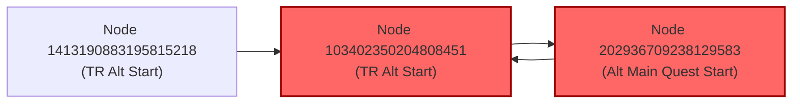

# Morrowind MWSE Lua Debugging & Repair Guide

A practical reference for diagnosing, inspecting, and resolving common Lua errors, UI lifecycle pitfalls, dialogue freezes, and mod conflicts in the Morrowind Script Extender (MWSE) environment.

---

## 1. Diagnostic Locations & Log Hierarchy

When an error occurs, consult log files in this order:

| Log File | Path | Typical Contents |
| :--- | :--- | :--- |
| **`MWSE.log`** | `Morrowind\MWSE.log` | Lua stack traces, runtime errors, MCM registrations, mod initialization banners. |
| **`Warnings.txt`** | `Morrowind\Warnings.txt` | Engine-level animation note problems, missing textures/meshes, broken script commands. |
| **`mwhangwatch.log`** | `Data Files\MWSE\logs\mwhangwatch.log` | Frame rate drops, memory usage, open UI menus at the exact moment of a freeze. |
| **Mod Logs** | `Data Files\MWSE\logs\<Mod>.log` | Dedicated debug traces for redirected mods (Graphic Herbalism, Enchantment Animation, etc.). |

---

## 2. Common Error Categories & Applied Fixes

### Category A: Nil-Indexing & Unsafe Reference Access

#### Symptom & Stack Trace
```text
mwfloatfix\main.lua:156: attempt to index field 'data' (a nil value)
```
or
```text
attempt to index a nil value (field 'keyCode')
```

#### Underlying Cause
* **`ref.data` on Non-Persistent Objects:** In MWSE, persistent custom Lua data (`ref.data`) is only supported on references that persist in save games (containers, NPCs, creatures, items). Accessing `.data` on statics, doors, or landscape objects can throw a nil-indexing error.
* **Missing Target Checks:** Probing targets (e.g. lockpicking, raycasts, dialogue actors) without verifying whether `e.target`, `mobile`, or `baseObject` exists.
* **Malformed Keybinds:** Accessing `keyCombo.keyCode` when an action is unbound or nil in MCM config tables.

#### Pattern & Fix
```lua
-- BAD
local customVal = ref.data.myKey

-- GOOD: Guard with supportsLuaData
if ref.supportsLuaData and ref.data then
    local customVal = ref.data.myKey
end
```

```lua
-- SAFE GETTER / SETTER PATTERN
local function getRefData(ref)
    if not ref or not ref.supportsLuaData then
        return nil
    end
    return ref.data
end

local function setRefData(ref, key, val)
    if not ref or not ref.supportsLuaData then
        return
    end
    ref.data[key] = val
end
```

```lua
-- SAFE KEYBIND CHECK (Binder.lua pattern)
function isUnbound(keyCombo)
    if not keyCombo then return true end
    local keyBound = (keyCombo.keyCode ~= false and keyCombo.keyCode ~= nil)
    local buttonBound = (keyCombo.mouseButton ~= false and keyCombo.mouseButton ~= nil)
    local wheelBound = (keyCombo.mouseWheel ~= false and keyCombo.mouseWheel ~= nil)
    return not (keyBound or buttonBound or wheelBound)
end
```

---

### Category B: UI Lifecycle & Element Destruction Traps

#### Symptom & Stack Trace
```text
MWSE\core\mcm\components\pages\exclusionspage.lua:227: sol: 'self' argument is lua_nil
```

#### Underlying Cause
* In MWSE's UI framework, destroying an element invalidates its C++ pointer immediately.
* Iterating over a child list and calling `:destroy()` while referencing `element.parent`, or calling `:destroy()` on elements during an event callback that later attempts to update layout on those same elements, results in `sol: 'self' argument is lua_nil`.

#### Pattern & Fix
```lua
-- BAD: Accessing parent after destroying child
for _, child in ipairs(container.children) do
    child:destroy()
end
container.parent:updateLayout() -- If container was invalidated, crash

-- GOOD: Cache parent reference first
local parent = element.parent
element:destroy()
if parent then
    parent:updateLayout()
end
```

> [!TIP]
> Always unregister recurring events (`preUpdate`, `update`, `keyDown`) inside the element's `destroy` callback using `e.element:registerAfter(tes3.uiEvent.destroy, cleanupCallback)`.

---

### Category C: Engine Console Commands vs. Legacy Script Commands

#### Symptom & Stack Trace
```text
Script command "TogglePOV" not found on line 1.
[C]: in function 'runLegacyScript'
.\Data Files\MWSE\mods\basicchargenaie\main.lua:81
```

#### Underlying Cause
* `tes3.runLegacyScript({ command = "..." })` submits text directly to the Morrowind Script Compiler (the legacy Morrowind `.esp` script engine).
* Commands like `TogglePOV`, `TCL`, `TAI`, `TFOW`, and `TM` are **engine console commands**, not script commands recognized by the compiler. Calling them via `runLegacyScript` causes a compilation error at runtime.

#### Pattern & Fix
Use MWSE's native Lua API methods instead of legacy scripts:

| Legacy Script Attempt | Native MWSE Replacement |
| :--- | :--- |
| `tes3.runLegacyScript({ command = "TogglePOV" })` | `tes3.setThirdPerson({ enabled = not tes3.is3rdPerson() })` |
| `tes3.runLegacyScript({ command = "MenuMode 1" })` | `tes3ui.enterMenuMode()` |
| `tes3.runLegacyScript({ command = "EnableInventoryMenu" })` | `tes3.enableInventoryMenu()` |

---

### Category D: Dialogue Linked-List Cycles (The Silent Freeze)

#### Symptom
* The game freezes completely when speaking to an NPC.
* The CPU is not racing (only 1 CPU thread is pinned, showing ~4–6% total CPU on modern multi-core systems).
* `MWSE.log` ends abruptly at `[Animated Dialogue] Dialogue started with '...'` or `uiActivated: MenuDialog`.
* `mwhangwatch.log` records `menu: MenuDialog` on its final line.

#### Underlying Cause
* In Morrowind, dialogue topics (`DIAL`) contain a doubly linked list of responses (`INFO` records) linked via `PNAM` (Previous Node) and `NNAM` (Next Node).
* When multiple mods modify the same dialogue entries (e.g. two conflicting alternate start mods modifying `Greeting 1` or `duties`), circular pointer chains can be created:
  $$\text{Node A} \xrightarrow{\text{NNAM}} \text{Node B} \xrightarrow{\text{NNAM}} \text{Node A}$$
* When `MenuDialog` opens, the engine traverses the linked list to find a matching greeting. It enters an infinite `while (info) { info = info->next }` loop in native C++ memory, locking the game before the UI can render.



#### Diagnostic & Fix Procedure
1. Identify all active plugins touching the relevant `DIAL` record (`Greeting 1`, `Greeting 5`, etc.).
2. Inspect the `INAM`, `PNAM`, and `NNAM` subrecords using an ESP parser.
3. Remove conflicting mods (e.g. disabling `Alternate Main Quest Start.ESP` when using `Tamriel Rebuilt - Alternate Start.esp`).
4. Re-link the broken node so `PNAM` and `NNAM` form a strict linear chain:
  $$\text{Node 1} \longleftrightarrow \text{Node 2} \longleftrightarrow \text{Node 3}$$

---

#### Second Cause: Not a Loop, Just Extremely Slow (MWSE `infoFilter` reading text)
Same symptoms, different cause: the dialogue list is fine, but an MWSE mod makes the greeting search crawl.

* **How the engine picks a greeting:** each greeting topic (`Greeting 0`-`9`) is one long list, checked top to bottom for every NPC until a response passes. There is no index by speaker, so an NPC whose lines sit far down the list walks past thousands of others first (e.g. *Ineone the Buoyant Armiger* puts 4,800 greetings at the top, all filtered to its own NPC).
* **What makes it crawl:** an `infoFilter` handler that reads `e.info.text` for every response the engine tries. `info.text` is not kept in memory; each read loads it from the plugin file on disk. Thousands of disk reads in one frame = minutes of "frozen" game (FPS 0; audio may keep playing).
* **Seen with:** `FriendsAndFrensJiubDelay` while talking to Ilav Imbrex (TR Alternate Start captain).
* **How to tell it apart from a real cycle:** `mwinfoloop` (MWSE mod) walks every topic at startup and logs real cycles (`0 with a loop` = not this); its live trace shows the search still advancing, one response after another.

```lua
-- BAD: reads text (a disk read) for every response the engine tries
local function onInfoFilter(e)
    local text = e.info.text
    if not string.find(text, "some line") then return end
    ...
end

-- GOOD: only look at responses that already passed, and only the dialogue types you care about
local function onInfoFilter(e)
    if not e.passes then return end
    local t = e.dialogue and e.dialogue.type
    if t ~= tes3.dialogueType.topic and t ~= tes3.dialogueType.greeting then return end
    local text = e.info.text
    ...
end
```
> [!TIP]
> Check `e.passes`, `e.dialogue.id`, `e.info.id` or `e.reference` first; read `e.info.text` last, and only when you must.

---

### Category E: Base Record Hijacking vs. Cell References

#### Symptom
* A world object (such as the Prison Ship in Teyn) is invisible and has no collision, dumping the player into the ocean.

#### Underlying Cause
* Some overhaul mods (e.g. `RR_Better_Ships_n_Boats_Eng.esp`) replace world models by modifying the **base object** (`ACTI chargen boat`) to use a 0-polygon dummy mesh (`RR\ex_dummy.nif`), rather than deleting or disabling specific cell references.
* When another mod places `chargen boat` elsewhere (e.g. Teyn harbor), that instance inherits the dummy mesh.
* Merged patch tools (Testool, tes3cmd, Multipatch) merge the base record change into `mwdialog_check Multipatch.esp`, placing the dummy at the end of the load order.

#### Pattern & Fix
1. **Never alter vanilla base records to dummy models in shared plugins:**
   Rename the dummy activator to a unique ID (e.g. `rr_dummyboat`) and reassign the local cell reference in Seyda Neen to use `rr_dummyboat`.
2. **Multipatch Hygiene:**
   Ensure the multipatch does not contain overrides pointing to dummy models:
   ```text
   Morrowind.esm:               chargen boat -> MODL = x\Ex_DE_ship.NIF
   Tamriel Rebuilt - Alt Start: chargen boat -> MODL = x\Ex_DE_ship.NIF
   Multipatch.esp:              chargen boat -> MODL = x\Ex_DE_ship.NIF
   ```

---

### Category F: Log Spam & Clean Startup Redirection

#### Symptom
* `MWSE.log` is flooded with hundreds of lines of autodetected records or event registrations on every launch, obscuring real warnings and errors.

#### Fix Architecture: Dedicated Logger Pattern
Add a scoped file logger that writes verbose diagnostic output to `Data Files\MWSE\logs\<ModName>.log` while emitting only a single summary line to `MWSE.log`:

```lua
local MOD_NAME = "MyMod"
local LOG_DIR = "Data Files\\MWSE\\logs"
local LOG_PATH = LOG_DIR .. "\\" .. MOD_NAME .. ".log"
local logFile

local function log(message, ...)
    local formatted = select("#", ...) > 0 and string.format(message, ...) or tostring(message)
    if not logFile then
        pcall(function() lfs.mkdir(LOG_DIR) end)
        logFile = io.open(LOG_PATH, "a")
    end
    if logFile then
        logFile:write(string.format("[%s] [%s] %s\n", os.date("%Y-%m-%d %H:%M:%S"), MOD_NAME, formatted))
        logFile:flush()
    end
end

-- In MWSE.log: single line only
mwse.log("[%s] Initialized Version %s", MOD_NAME, VERSION)

-- Verbose registration/blacklist lines:
log("Container '%s' added to blacklist.", id)
```

---

### Category G: Runaway Per-Frame Work, Absurd Priorities & Jobs That Never Stop

#### Symptom
* Low or uneven FPS with many MWSE mods installed, stutter that grows over a session, Lua memory climbing
  every second (`mwhangwatch.log` shows it), even though no single mod looks broken.

#### Underlying Cause
* **Every-frame handlers:** `event.register(tes3.event.simulate | enterFrame | update | preUpdate, ...)` runs
  60+ times a second. Most mods that do it only need to check something a few times a second.
* **Tight repeating timers:** `timer.start({ duration = 0.01, iterations = -1, ... })` is every frame in disguise.
* **Absurd priorities:** `{ priority = 1000000 }` (or `-1000000`) to be "first". Priorities only order handlers
  of the same event; a huge number fights every other mod for nothing and can skip their blocking/filters.
* **One-shot jobs that never stop:** a mod that fixes something once (patches records at load, waits for a
  global to change, places an object) but keeps its handler or timer running for the rest of the session.

#### Pattern & Fix
* **Rule: at least 0.35 s between repeating calls**, unless the work truly must happen every frame.
* **Exceptions (leave per-frame):** camera control (`cameraControl`), movement/physics that must be smooth,
  UI animation/drag, input that must react the same frame, `calcMoveSpeed`-style per-actor events.

```lua
-- BAD: every frame
event.register(tes3.event.simulate, function() checkStuff() end)

-- GOOD: a repeating timer at 0.35 s (or more)
timer.start({ type = timer.simulate, duration = 0.35, iterations = -1, callback = checkStuff })

-- GOOD (if it must stay on simulate): throttle inside
local acc = 0
event.register(tes3.event.simulate, function(e)
    acc = acc + e.delta
    if acc < 0.35 then return end
    acc = 0
    checkStuff()
end)
```

```lua
-- BAD: absurd priority
event.register(tes3.event.activate, onActivate, { priority = 1000000 })
-- GOOD: default priority (0), or a small, documented offset when ordering really matters
event.register(tes3.event.activate, onActivate, { priority = 10 })
```

```lua
-- BAD: does its job once, keeps running forever
event.register(tes3.event.simulate, function()
    if not done and tes3.getGlobal("SomeQuest") >= 50 then fixThing(); done = true end
end)
-- GOOD: stop when done
local function waitForQuest()
    if tes3.getGlobal("SomeQuest") >= 50 then
        fixThing()
        event.unregister(tes3.event.simulate, waitForQuest)   -- or t:cancel() for a timer
    end
end
event.register(tes3.event.simulate, waitForQuest)
```
> [!TIP]
> Timers started with `iterations = -1` should keep the timer handle (`local t = timer.start{...}`) so they
> can `t:cancel()` themselves when the job is finished. Re-register on `loaded` if the job must run once per save.

---

### Category H: Image Format Conversions (.tga vs .dds), Hardcoded Paths & Loading Screen D3D Pitfalls

#### Symptom & Stack Trace
```text
Class: : Unable to dereference
String: "Data Files\Splash\01_Morrowind_Basegame\Morrowind.tga"
Name: CustomRegionSplash_bg
MiniDump creation failed. Error: 0x8007001F
```
or missing UI texture boxes, blank icons in MCM / quickloot, or crash `0xC0000409` (`__fastfail`) during cell transitions.

#### Underlying Cause
* **NetImmerse Missing Direct Fallbacks:** In 3D `.nif` meshes, the engine can swap `.tga` for `.dds` automatically. However, when textures are directly loaded by path in Lua via `tes3.loadTexture`, `element:createImage{ path = ... }`, or `element.contentPath`, NetImmerse checks the exact filename. If code requests `.tga` but the texture was re-encoded or deployed as `.dds`, the engine returns `nil` or leaves an invalid texture pointer.
* **Format-Specific Directory Scanners:** Code using hardcoded filters like `if file:lower():match("%.tga$") then` skips `.dds` files completely when users convert splashes or icons.
* **DDS Header Layout Differences:** When pre-validating image dimensions to guard against 32-bit OOM, TGA stores width/height as 16-bit uints at bytes 13–16. DDS files start with magic `"DDS "` and store height at bytes 13–16 and width at bytes 17–20 as 32-bit uints. Treating a DDS as a TGA produces garbage dimension reads.
* **Loading Screen D3D Device Lockup:** Calling `menu:updateLayout()` inside a high-frequency real-time timer (e.g. 0.25 s) while `MenuLoading` is visible causes DirectX 9 device resource contention during cell streaming, resulting in `0x8007001F` (`ERROR_GEN_FAILURE`) and CTD.

#### Pattern & Fix

```lua
-- BAD: Only scans for .tga; misses .dds completely
for file in lfs.dir(path) do
    if file:lower():match("%.tga$") then
        table.insert(images, file)
    end
end

-- GOOD: Scans both .dds and .tga, prioritizing .dds when both exist
local candidates = {}
for file in lfs.dir(path) do
    local lower = file:lower()
    local isDds = lower:match("%.dds$")
    local isTga = lower:match("%.tga$")
    if isDds or isTga then
        local base = lower:gsub("%.dds$", ""):gsub("%.tga$", "")
        if not candidates[base] or isDds then
            candidates[base] = file
        end
    end
end
for _, file in pairs(candidates) do
    table.insert(images, file)
end
```

```lua
-- SAFE DUAL-FORMAT DIMENSION CHECK (TGA + DDS)
local function isSafeImage(relPath)
    local f = io.open("Data Files\\" .. relPath, "rb")
    if not f then return false end
    local hdr = f:read(24)
    f:close()
    if not hdr or #hdr < 18 then return false end

    local w, h
    if #hdr >= 20 and hdr:sub(1, 4) == "DDS " then
        h = hdr:byte(13) + hdr:byte(14) * 256 + hdr:byte(15) * 65536 + hdr:byte(16) * 16777216
        w = hdr:byte(17) + hdr:byte(18) * 256 + hdr:byte(19) * 65536 + hdr:byte(20) * 16777216
    else
        w = hdr:byte(13) + hdr:byte(14) * 256
        h = hdr:byte(15) + hdr:byte(16) * 256
    end

    -- Skip oversized textures (>2560x1440) that exhaust 32-bit address space
    return (w <= 2560 and h <= 1440)
end
```

```lua
-- BAD: Repetitive real-time timer forcing layout draws during background cell streaming
timer.start({
    duration = 0.25,
    iterations = -1,
    callback = function()
        m:findChild("MenuLoading_progressBar"):bringToFront()
        m:updateLayout() -- Direct3D 9 lockup hazard (0x8007001F)
    end
})

-- GOOD: Layer UI elements once in uiActivated, without per-frame or repeating timers
local pb = menu:findChild(tes3ui.registerID("MenuLoading_progressBar"))
if pb then
    pb.absolutePosAlignX = 0.5
    pb.absolutePosAlignY = 0.9
    pb:bringToFront()
end
menu:updateLayout()
```

---

### Category I: 3D Audio Loop Runaways & Non-Actor GetSoundPlaying Engine Traps

#### Symptom & Diagnostic Evidence
* Frame stutter, audio crackling, channel exhaustion, and runaway log entries in `Data Files\MWSE\logs\mwsoundguard.log`:
  ```text
  RUNAWAY loop: Cave Drip (3 restarts within 1.0 s) on Sound_Cave_Drip00 in cell Addamasartus; engine says playing: no; 4 start(s) in 0.02 s
  Sound_Cave_Drip00|Cave Drip: 22788 blocked
  RUNAWAY loop: IE_tav_imp_1 on ex_common_door_01 in cell Seyda Neen (-2, -9); engine says playing: no; 5 start(s) in 2.01 s
  ```

#### Underlying Cause (Engine Bug)
* Morrowind's 3D audio engine (Miles Sound System) does not properly track or report active 3D looping sound emitters on **non-actor references** (doors, activators, lights, statics, containers) when queried via `GetSoundPlaying` (MWScript) or `tes3.getSoundPlaying{ sound = ..., reference = ref }` (MWSE).
* Even while a 3D sound loop is actively playing on a door or activator, the engine query consistently answers `0` / `false` ("not playing").
* Any script (MWScript or MWSE Lua) that checks `if not getSoundPlaying(...) then playLoopSound(...)` in a per-frame event (`simulate`, `enterFrame`) or a repeating timer will falsely believe the sound is not playing and launch a new loop on every single tick.
* Without a runtime blocker like `mwsoundguard`, tens of thousands of duplicate audio channels are requested, exhausting DirectX/Miles sound channels and causing severe frame drops, audio stutter, and CTDs.

#### Locating Runaway Sound Scripts
1. **Runtime Verification**:
   - Check `Data Files\MWSE\logs\mwsoundguard.log` after a play session. Any entry under `RUNAWAY loop` or entries in the summary with high block counts (`> 10 blocked`) pinpoint the exact reference, sound file, and owning script.
2. **Static Lua Detection**:
   - `mwdialog_luafix.py` reports these as rule **S1** (report only, never patched: a safe rewrite has to know where each mod stops its sound, and a blanket "non-actors are always playing" answer would stop AURA's door wind and weather loops from ever starting).
   - Search MWSE mods for references to `getSoundPlaying` combined with `playLoopSound3D` on non-actor references:
     - `tes3.getSoundPlaying` called inside a repeating timer callback or `simulate`/`enterFrame` handler.
     - The target reference is a door, activator, static, or generic reference without an actor check (`objType == tes3.objectType.npc or objType == tes3.objectType.creature`).
3. **Static MWScript Detection**:
   - Search compiled and decompiled scripts in plugins for:
     ```mwscript
     if ( GetSoundPlaying "<SoundID>" == 0 )
         PlayLoopSound3DVP "<SoundID>", ...
     ```
     running unconditionally in object scripts (such as `Cave Drips.ESP`, `Yet Another Better Sounds Patch.esp`, or Expanded Sounds `Float`).

#### Safe Patterns

```lua
-- BAD: Relies on engine getSoundPlaying on non-actors (doors, statics, activators)
function updateDoorAudio(door, soundTrack)
    if not tes3.getSoundPlaying{ sound = soundTrack, reference = door } then
        tes3.playLoopSound3D{ sound = soundTrack, reference = door } -- SPAMS EVERY TICK!
    end
end

-- GOOD: Track started loops in Lua state or reference tempData
local activeDoorLoops = setmetatable({}, { __mode = "k" })

function updateDoorAudioSafe(door, soundTrack)
    if activeDoorLoops[door] == soundTrack then
        return -- Already playing; do not ask engine
    end
    activeDoorLoops[door] = soundTrack
    tes3.playLoopSound3D{ sound = soundTrack, reference = door }
end

function stopDoorAudioSafe(door, soundTrack)
    if activeDoorLoops[door] then
        activeDoorLoops[door] = nil
        tes3.removeSound{ sound = soundTrack, reference = door }
    end
end
```

```lua
-- SAFE GET-TRACK HELPER (AURA / Ambient Mod Pattern)
function getTrackPlayingSafe(track, ref)
    if not track or not ref then return nil end
    local obj = ref.object
    local objType = obj and obj.objectType
    -- If non-actor, bypass engine check and rely on Lua tempData tracking
    if objType ~= tes3.objectType.npc and objType ~= tes3.objectType.creature then
        if ref.tempData and ref.tempData.currentTrack == track then
            return track
        end
        return nil
    end
    -- Actors correctly report playing state to the engine
    if tes3.getSoundPlaying{ sound = track, reference = ref } then
        return track
    end
    return nil
end
```

```mwscript
; SAFE MWSCRIPT PATTERN (Object Scripts on Activators/Statics/Lights)
; BAD:
; if ( GetSoundPlaying "Cave Drip" == 0 )
;     PlayLoopSound3DVP "Cave Drip", 1.0, 1.0
; endif

; GOOD: Use state variable gated on CellChanged
short soundStarted

if ( CellChanged == 1 )
    set soundStarted to 0
endif

if ( soundStarted == 0 )
    PlayLoopSound3DVP "Cave Drip", 1.0, 1.0
    set soundStarted to 1
endif
```

---

## 3. Vortex Staging & Hardlink Safeguards

> [!WARNING]
> If a mod is managed by Vortex, its files in `Data Files` are NTFS hard links pointing to its configured staging folder.

* Editing a file in `Data Files` via some text editors or file writers breaks the hard link by writing a new file with a new inode.
* When Vortex subsequently runs "Deploy", it overwrites `Data Files` with the unpatched staging copy.
* **Safe Practice:**
  1. Always update or overwrite the file in the **Vortex staging folder** simultaneously.
  2. Verify hardlink parity using Windows `fsutil`:
     ```powershell
     fsutil hardlink list "Data Files\ModName.esp"
     ```
