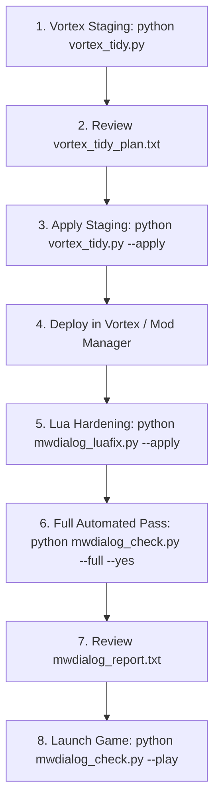

# Morrowind Plugin Management & Engine Hardening Suite — Wiki Reference Guide

This document provides a comprehensive technical overview, command-line argument reference, architecture manual, and best practices guide for the Morrowind Plugin Conflict, Asset Management, and Engine Hardening Toolchain.

---

## 1. Executive Summary & Evolution

What started as a focused dialogue conflict and cyclic loop scanner (`mwdialog_check.py`) evolved into an aggressive, full-spectrum diagnostic, repair, and mod management toolchain.

To solve conflicts that pure record patching could not address, the toolchain split into two complementary halves:
1. **Offline Static Analysis & Patching Engine (Python 3):** Analyzes plugins (`.esp`/`.esm`), BSA archives, loose disk assets, load order manifests, and Vortex staging folders. Cleans dirty edits, generates dynamic resolution patches (`Multipatch.esp`, `AutoMerge.esp`, `Cell Fixes.esp`, `Performers Patch.esp`), fixes voice/sound links, downscales oversized textures, shortens long paths, and exports spatial collision/stranded databases.
2. **Runtime Engine Hardening Suite (`mwsuite` MWSE Lua):** A suite of 18 specialized Lua plugins living in `Data Files/MWSE/mods/mw*`. These consume offline spatial manifests (e.g. `mwcollide_data.json`, `mwstranded_data.json`) to dynamically hide overlapping duplicate meshes or rescue void-stranded items at runtime, while actively guarding against engine lockups, infinite dialogue loops, audio-buffer crashes, exit deadlocks, and script-induced teleportation glitches.

---

## 2. System Architecture & Modular Breakdown

Following major refactoring passes, the core monolith `mwdialog_check.py` delegates self-contained responsibilities to 18 dedicated modules while maintaining backwards-compatible CLI exports:

| Module | Core Responsibility |
| :--- | :--- |
| `mwdialog_check.py` | Top-level CLI orchestration, pipeline passes (`--full`, `--all`), multi-stage scan state, and report generation. |
| `mwdialog_tes3.py` | Low-level TES3 record/subrecord binary parser/serializer, zero-data-loss string encoding/decoding (`ENC`), and memory-cached file reads. |
| `mwdialog_records.py` | High-level record transformations: object field merging (TES3Merge-style), leveled-list synthesis, cell record splitting, and subrecord cleaning. |
| `mwdialog_cellmods.py` | Spatial 3D conflict analysis, cell grid tracking, bounding radius collision checks, and export of `mwcollide_data.json` & `mwstranded_data.json`. |
| `mwdialog_mastercheck.py` | Heuristic validation of plugin masters. Determines if a patch was built for a different master version or missing masters using reference analysis and archive lookups. |
| `mwdialog_loadorder.py` | Load-order calculation, date-stamp manipulation (one-day spacing), and mlox-style rule parsing (`mwdialog_check.rules.txt`). |
| `mwdialog_redundant.py` | Identifies redundant or completely shadowed plugins (plugins providing zero unique overrides or duplicated mod versions). |
| `mwdialog_assets.py` | Asset validation engine: detects missing textures, models, sounds, corrupted DDS headers, missing mipmaps, and uncompressed textures. |
| `mwdialog_media.py` | Binary formats for assets: DDS header reading/downscaling, NIF node traversal/text keys, and sound file header verification. |
| `mwdialog_bsa.py` | BSA archive indexer, hash-lookup table builder, and virtual asset locator. |
| `mwdialog_longpaths.py` | Windows `MAX_PATH` (260 char) and Morrowind fixed-length string buffer violation detection and path relocation. |
| `mwdialog_datatree.py` | Virtual file system layer abstracting `Data Files`, BSA archives, and Vortex staging folders into a unified lookup tree. |
| `mwdialog_patchfile.py` | Synthesis of ESM and record patches (`mwdialog_check - ESM fixes.esp`, placeholder records, missing quest objects). |
| `mwdialog_backup.py` | Safe backup registry (`.bak`, `.esp.bak`), file timestamp preservation, and atomic file replacements. |
| `mwdialog_state.py` | Persistent state tracking (`mwdialog_conflict_answers.json`, `mwdialog_cell_winners.txt`, `mwdialog_disabled.txt`). |
| `mwdialog_generated.py` | Creation and tracking of dummy placeholders (silent audio, marker NIFs, dummy icons) and texture downscale caches. |
| `mwdialog_restore.py` | Comprehensive rollback subsystem for reverting backups, restoring load order dates, and undeploying generated files. |
| `mwdialog_console.py` | Interactive terminal UI, progress bars, interactive conflict prompts, and logging. |
| `mwdialog_text.py` | Terminal word wrapping (115 columns), hanging indent formatting, and ANSI escape handling. |
| `vortex_tidy.py` | Offline staging organizer. Removes junk/docs, fixes misplaced paths, and operates on a strict plan-then-apply paradigm. |
| `mwdialog_luafix.py` | AST-based Lua parser (`mwdialog_lua.py`) and static repair tool for MWSE mods (guards against nil indexing, priority bugs, and log spam). |

---

## 3. `mwdialog_check.py` CLI Argument Reference

`python mwdialog_check.py [options] <data_dir>`

### 3.1. General & Target Configuration
* `data_dir` *(positional, required)*: Path to the target Morrowind `Data Files` directory.
* `--plugins FILE [FILE ...]`: Explicit list of plugins to check, overriding `mwdialog_load_order.txt` and `Morrowind.ini`.
* `--ini INI`: Path to `Morrowind.ini`. Used to read registered `[Archives]` and sync active `[Game Files]`.
* `--openmw-cfg OPENMW_CFG`: Reads `content=` and `data=` fallback lines from an OpenMW configuration file.
* `--only FILE [FILE ...]`: Scopes diagnostic reporting and fixes strictly to the specified plugin(s).
* `--min-severity {ERROR,WARN,INFO}`: Minimum reporting threshold. Default is `WARN`. Use `INFO` to inspect benign master or dialogue notices.
* `--encoding ENCODING`: Text code page for plugin strings (default `cp1252` for English; use `cp1251` for Russian, `cp1250` for Polish).
* `--csv PATH`: Exports the comprehensive diagnostic report to a structured CSV file.

### 3.2. Dialogue & Record Fixing Subsystem
* `--fix`: Generates and executes a repair plan for `ERROR` severity issues. ESP files are patched in place (backed up to `.esp.bak`). ESM issues are redirected into a newly generated `mwdialog_check - ESM fixes.esp`.
* `--dry-run`: Simulates the requested actions (fixing, merging, cleaning, or asset processing) and prints the planned operations without modifying any files.
* `--yes`: Skips interactive terminal confirmation prompts and executes planned changes immediately.
* `--patch-esm`: Alias for `--fix` (maintained for backwards compatibility with legacy batch scripts).
* `--no-placeholders`: Disables the generation of stand-in gold/marker objects for missing object IDs referenced in scripts.
* `--bug-reports`: Writes individual `<plugin>.bugreport.txt` files for plugins containing fatal syntax or structural issues.
* `--no-bug-reports`: Disables `<plugin>.bugreport.txt` generation.

### 3.3. Master Integrity Guard (`mwdialog_mastercheck`)
* `--disable-mismatched`: Deactivates plugins built for a different master revision than the one installed (based on unresolved record references and header sizes).
* `--mismatch-threshold 0-1`: Confidence threshold (0.0 to 1.0) required to flag a master mismatch (default: `0.75`).
* `--vortex-downloads, --downloads DIR`: Path to the Vortex archive download cache. Allows the checker to inspect original mod archive headers before in-place fixes modified them.
* `--no-archive-lookup`: Disables inspection of external 7z/RAR/ZIP download archives for master mismatch scoring.
* `--no-master-guard`: Bypasses master version matching entirely.

### 3.4. Load Order Sorting (`mwdialog_loadorder`)
* `--sort`: Sorts active plugins by updating file system modification dates (1-day increments). Ensures ESM masters precede dependent ESPs, followed by rules in `mwdialog_check.rules.txt` and mlox rules (`mlox_user.txt`/`mlox_base.txt`).
* `--no-mlox-rules`: Restricts sorting rules strictly to `mwdialog_check.rules.txt`, ignoring installed mlox rule lists.
* `--update-rules`: Prunes obsolete or conflicting rules from mlox rule files when overridden by master constraints or custom user rules.
* `--no-add-masters`: Prevents automatic injection of parent plugins as ESM masters into dependent patch plugins during sort.
* `--no-content-order`: Disables automatic heuristic rule generation that loads small override patches after the larger mod whose records they modify.
* `--restore-dates`: Reverts file modification dates to their state prior to the last `--sort` invocation.
* `--add-all-esp`: Activates every `.esm` and `.esp` found in `Data Files` into `mwdialog_load_order.txt` (masters first, sorted by date; excludes MGE XE distant grass plugins).

### 3.5. Redundancy & Shadowed Mod Management (`mwdialog_redundant`)
* `--redundant`: Scans the load order for redundant mods (plugins providing no unique records, or superseded duplicate versions of another mod) and prompts for action.
* `--redundant-auto`: Automatically disables high-confidence redundant plugins (plugins that make zero effective changes and have no dependents) without interactive prompting.
* `--no-redundant`: Skips the redundancy pass when running `--full`.
* `--redundant-undo [NAME ...]`: Reactivates plugins previously disabled by `--redundant`.

### 3.6. Cell & 3D Spatial Conflict Arbitration (`mwdialog_cellmods`)
* `--cell-conflicts`: Deep analysis of overlapping cell edits. Identifies mods modifying the same cell coordinates, placed objects, or lighting/water settings. In interactive mode, prompts to assign winning layouts (`mwdialog_cell_winners.txt`), toggle mods, or record order preferences. Outputs spatial runtime manifests:
  - `mwcollide_data.json`: Coordinates of overlapping placed objects within radius to be hidden by `mwcollide`.
  - `mwstranded_data.json`: Objects orphaned in the void by interior remodels, to be managed by `mwstranded`.
  - Generates `mwdialog_check Cell Fixes.esp` when needed.
* `--conflict-all-places`: Includes minor object placements that are close together (normally handed off to `mwcollide` without prompting).
* `--conflict-min N`: Minimum number of placed objects a mod must add to a cell to trigger a conflict report (default: `5`).
* `--conflict-top N`: Limits summary output to the N most severe cell conflicts (default: `40`).
* `--conflict-all`: Displays every single detected cell conflict pair.
* `--collide-radius UNITS`: Distance threshold (in Morrowind engine units) used to identify colliding meshes for `mwcollide` (default: `32` units; `0` checks identical models within 64 units).
* `--only-new`: Replays previously recorded answers (`mwdialog_conflict_answers.json`) and prompts only for unresolved pairs.
* `--fresh-answers`: Ignores recorded answers during `--full` and forces a fresh query pass.
* `--use-answers`: Applies all existing answers in `mwdialog_conflict_answers.json` headlessly without interactive prompts.
* `--no-interactive`: Runs cell conflict analysis in reporting mode only, suppressing keyboard prompts.
* `--performers-patch`: Generates `mwdialog_check Performers Patch.esp` to delete duplicate bard NPCs in inns, rather than relying on runtime hiding via `mwperformers`.
* `--no-performers`: Disables duplicate inn performer resolution.
* `--no-doubled`: Disables detection of duplicate mod instances that place identical records twice.
* `--reenable [NAME ...]`: Re-enables plugins turned off as doubled or conflicting (reads `mwdialog_disabled.txt`).

### 3.7. Record Cleaning & Multipatch (`mwdialog_records`, `mwdialog_multipatch`)
* `--clean`: Performs in-place plugin cleaning equivalent to `tes3cmd clean`: strips duplicate object instances, redundant cell AMBI/WHGT records, unchanged copies of master records, "Evil GMSTs", and empty junk cells. Backs up to `.esp.bak`.
* `--multipatch`: Synthesizes `mwdialog_check Multipatch.esp` (similar to `tes3cmd multipatch` + `TES3Merge`). Merges leveled lists across all active mods, fixes cell fog distance bugs, restores cell names, and performs field-by-field subrecord merging for NPCs, creatures, items, and spells. Must load last.
* `--no-merge-objects`: Disables subrecord object merging within the Multipatch, limiting it to leveled lists and cell fixes.

### 3.8. Plugin Merging Subsystem
* `--merge OUT.esp [INPUT ...]`: Merges specified input plugins into `OUT.esp`. Verifies master dependencies and skips plugins missing required masters. Later inputs win record conflicts.
* `--auto-merge`: Automatically identifies clean, non-conflicting ESPs (no scripts, no cell/land/pathgrid modifications) that can be merged without altering override hierarchy, combines them into `mwdialog_check AutoMerge.esp` (or `--merge-name`), and deactivates the originals (logged to `mwdialog_merged.txt`).
* `--merge-name NAME.esp`: Custom filename for `--auto-merge`.
* `--unmerge [NAME.esp ...]`: Rolls back an auto-merge, deactivating the merged plugin and restoring individual source plugins.
* `--merge-all`: Forces inclusion of all specified plugins into the merge, bypassing master dependency checks.
* `--merge-with PLUGIN [PLUGIN ...]`: Specifies inactive context plugins that satisfy master dependencies during merge validation.
* `--no-follow-up, --no-follow-fix`: Suppresses automatic execution of follow-up passes (`--fix` and `--multipatch`) after a merge or sort.

### 3.9. Asset & Media Health Engine (`mwdialog_assets`, `mwdialog_media`)
* `--asset-check`: Deep audit of all assets referenced by active plugins, scripts, and `Morrowind.ini` (meshes, textures, sounds, music, icons, splash screens, fonts). Scans BSA archives and searches Vortex staging folders for missing files. In `--fix` mode, extracts missing files or deploys dummy assets.
* `--repair-sounds`: Inspects active WAV and MP3 files. Uses `ffmpeg` to re-encode problematic 24-bit/32-bit float audio, non-standard PCM codecs, and MP3s with large ID3v2 tags that cause engine crashes or freezes. Original files are safely moved to `Off/<plugin>/`.
* `--no-sounds`: Skips validation of voice and sound asset paths.
* `--restore-textures`: Restores full-resolution textures that were previously downscaled to 2048px (reads `mwdialog_reduced_textures.txt`).
* `--remove-generated`: Deletes all generated silent audio and placeholder assets created by previous repair runs (reads `mwdialog_generated_files.txt`).
* `--vortex-dir PATH`: Explicit path to Vortex staging directory.
* `--no-vortex`: Disables searching Vortex staging folders for un-deployed assets.

### 3.10. Rollback, Backups & Undo System
* `--restore FILE [FILE ...]`: Restores specified plugins from their newest `.bak` backup file (preserves timestamps).
* `--restore-all`: Performs a total rollback: restores every plugin in `Data Files` from its oldest original `.bak` and purges intermediate backups.
* `--clean-up`: Prunes orphaned `.bak` files for plugins no longer in `Data Files` and consolidates multiple backups to the latest copy.
* `--fix-log FIX_LOG`: Custom output path for fix audit records (default: `mwdialog_fixes.log`).
* `--longpaths-undo`: Reverts file path shortening done by `mwdialog_longpaths.py`, restoring original long paths in plugins and models.
* `--restore-unused`: Restores unused loose textures/sounds that were quarantined to `Off\unused\`.

### 3.11. Omnibus Pipelines & Direct Execution
* `--all`: Executes the standard three-stage sequence: `--clean`, then `--fix`, then `--multipatch`.
* `--full`: The ultimate end-to-end management pipeline:
  1. Validates master existence (aborts immediately if any master is missing).
  2. Rolls back temporary disables and unmerges previous auto-merges.
  3. Audits cell conflicts (read-only pass).
  4. Executes load order `--sort`.
  5. Runs `--all` along with `--asset-check`. If unfixable errors remain, halts and displays `mwdialog_report.txt`.
  6. Executes `--auto-merge`, re-sorts, and re-runs `--all`.
  7. Presents interactive cell conflict prompts for unresolved interior conflicts.
  8. If `--play` is specified, launches the game immediately.
* `--play`: Launches `Morrowind.exe` directly, setting `SteamAppId=22320` in the environment to bypass the Morrowind Launcher.
* `--play-anyway`: Forces game launch via `--play` even if master ordering errors or missing masters are detected.
* `--steam-appid STEAM_APPID`: Custom Steam App ID (default: `22320`).
* `--exe EXE`: Executable name to launch (default: `Morrowind.exe`).

### 3.12. Inspection & Metadata Tools
* `--trace ID [ID ...]`: Traces specific object IDs through the entire load order, identifying defining plugins, reference placers, deletion overrides, and referencing scripts.
* `--header FILE [FILE ...]`: Displays the Author and Description fields in the TES3 header of the target plugin.
* `--set-author TEXT`: Updates the Author header (`+text` appends).
* `--set-description TEXT`: Updates the Description header (`+text` appends; `\n` formats newlines).

---

## 4. Companion Tools: `vortex_tidy.py` & `mwdialog_luafix.py`

Both companion tools operate under a **Strict Plan-Then-Apply Workflow**:
1. Running without `--apply` generates an explicit plain-text plan (`vortex_tidy_plan.txt` or `mwdialog_luafix_plan.txt`).
2. Review the generated plan.
3. Running with `--apply` validates the plan. If on-disk state shifted since plan generation, `--apply` refuses to execute (exit code 2) and saves `<plan>.prev.txt`.
4. Upon successful application, the plan file is cleared to prevent accidental re-runs, and operations are logged to a JSONL journal (`*_journal.jsonl`) for rollback via `--undo`.

### 4.1. `vortex_tidy.py`
Cleans and normalizes Vortex staging directories before deployment into `Data Files`.
* Quarantines non-game documentation, screenshots, and tools to `Off/`.
* Reorganizes incorrectly nested folder hierarchies (e.g. `Data Files/Data Files/Textures` -> `Textures`).
* Converts or isolates incompatible normal maps (`*_n.dds`).
* Downscales 4K/8K textures to 2048px (using `texconv.exe`).
* Normalizes file paths exceeding Windows `MAX_PATH` limits.
* Key arguments:
  - `--staging PATH`: Path to Vortex mod staging directory.
  - `--downloads PATH`: Path to Vortex downloads folder.
  - `--lua-only`: Regenerates only the Lua syntax/hardening section of the plan.
  - `--apply`: Enacts the reviewed `vortex_tidy_plan.txt`.
  - `--undo`: Reverses moves and repairs recorded in `vortex_tidy_journal.jsonl`.

### 4.2. `mwdialog_luafix.py`
A pure-Python AST-based static analyzer and hardening engine for MWSE Lua scripts.
* Replaces regex heuristics with proper Lua 5.1/LuaJIT tokenization and AST parsing (`mwdialog_lua.py`).
* Patches dangerous nil dereferences on event tables (e.g. unverified `e.target` or `e.reference`).
* Normalizes out-of-bounds event priorities (clamps extreme negative/positive priorities that break event chains).
* Injects log-spam suppression wrappers around noisy mod loops.
* Verifies script syntax using local `luajit`/`luac` before writing modifications.
* Key arguments:
  - `[folders ...]`: Target mod directories to scan.
  - `--apply`: In-place patches Lua scripts according to `mwdialog_luafix_plan.txt`.
  - `--undo`: Reverts all AST modifications using `mwdialog_luafix_journal.jsonl`.

---

## 5. The `mwsuite` of MWSE Lua Runtime Plugins

Located in `Data Files/MWSE/mods/`, these 19 Lua plugins provide real-time runtime engine hardening, spatial conflict arbitration, and crash prevention:

| Plugin Name | Category | Primary Function & Engine Mitigation |
| :--- | :--- | :--- |
| `mwcollide` | Spatial Conflict | Reads `mwcollide_data.json` (exported by `mwdialog_check --cell-conflicts`). On cell load, dynamically disables/hides overlapping duplicate objects placed in the same spot by uncoordinated mods. |
| `mwcriminal` | Crime / Stealth | Consolidates theft, lock and door rules with companion/creature sneak detection, Attend Me interop, and the detector/blacklist inspector. |
| `mwstranded` | Spatial Conflict | Reads `mwstranded_data.json`. Detects items placed in coordinates that are now empty void due to another mod rebuilding the interior layout. Repositions or hides them to prevent void drops. |
| `mwperformers` | Conflict Fix | Enforces "one band per inn". If multiple mods place bards, lutenists, or drummers in the same tavern, dynamically hides duplicate performers. |
| `mwfloatfix` | Physics / World | Settle floating items. On cell load, casts vertical downward rays from ungrounded loose items (books, potions, misc items) and drops them onto the actual surface mesh. |
| `mwinfoloop` | Dialogue Engine | Circular dialogue loop guard. At startup, walks response trees across all active plugins to detect circular links. In dialogue, catches infinite topic cycles and breaks the loop before the engine freezes. |
| `mwsoundguard` | Audio Engine | Audio buffer crash guard. Prevents rapid sound stacking and loop bugs (such as the Expanded Sounds lantern bug) where an object calls `PlayLoopSound3D` every frame, overflowing the sound buffer. |
| `mwhangwatch` | Diagnostics | Watchdog profiler. Flushes stats every second to `mwhangwatch.log`. Survives hard engine freezes so you can identify the exact script, cell, or memory state that caused a crash. |
| `mwguard` | Profiling | Passive profiler. Times per-frame event handler execution and records extreme priorities to `MWSE/logs/mwguard.log` without altering other mods. |
| `mwexitguard` | Stability | Clean exit accelerator. Intercepts menu exit, message prompts, and Alt+F4 to terminate `Morrowind.exe` cleanly and instantly, preventing notorious `d3d8.dll` / MGE XE renderer teardown deadlocks. |
| `mwteleportguard` | Stability | Safe dialogue teleportation. Catches scripts calling `PositionCell` while `MenuDialog` is open. Defers teleportation until the dialogue UI closes, avoiding camera lockups and actor corruption. |
| `mwmouseguard` | Multi-Monitor | Multi-monitor protection. Traps and locks the cursor inside the Morrowind window in borderless mode, preventing cursor bleed onto secondary monitors and accidental inactive scroll events. |
| `mwsaveguard` | Data Integrity | Save state validator. Inspects save game records before and after writing to prevent corrupted save game states. |
| `mwcustomclasspersistence`| UI / Mechanics | Custom class memory. Saves custom character classes created during Character Generation to `savedCustomClasses.json`, allowing them to be chosen directly in future playthroughs. |
| `mwplainpaperfix` | UI Quality-of-Life| Activating blank scroll paper places it directly into the player inventory instead of opening an empty, interactive scroll UI window. |
| `mwpersonaleffects` | Quest Fix | Standalone, opt-in Lua replacement for Personal Effects' Census and Excise scripts; retains the required ESP records. |
| `mweffectinspector` | Developer Tools | Console debugger (`inspecteffects`, `showeffects`) allowing real-time inspection of active magic effects, modifiers, and sources on any actor. |
| `mwpluginpatches` | Bug Fixes | Bundles micro-patches for common mod script bugs (Jiub delay, Ysmir shield fix, guard response scripts) directly in Lua. |
| `mwwarnsuppression` | Log Cleanup | Suppresses repetitive, benign engine warning spam (missing optional body parts, trivial Morrowind.ini warnings) in `Warnings.txt`. |

> [!NOTE]
> `dejespreplacements` (formerly `mwespreplacements`) is intentionally excluded from the public tool suite. It contains user-specific overrides tailored to a private install/load order rather than general-purpose engine tooling.

---

## 6. Best Practices Guide for Modding & Maintenance

### 6.1. The Recommended End-to-End Maintenance Workflow
For large mod lists (300 to 1,000+ plugins), follow this operational sequence:

1. **Purge & Stage Clean:** Run `python vortex_tidy.py`, review the plan, run with `--apply`, then deploy mods in Vortex.
2. **Lua Static Hardening:** Run `python mwdialog_luafix.py`, verify detected scripts, and run `--apply`.
3. **Master & Load Order Validation:** Run `python mwdialog_check.py --add-all-esp --sort --disable-mismatched`.
4. **Cell Conflict Resolution:**
   - Run `python mwdialog_check.py --cell-conflicts --only-new` to resolve new interior overlaps.
   - Answers are preserved in `mwdialog_conflict_answers.json`.
5. **Full Synthesis Pass:** Run `python mwdialog_check.py --all --asset-check`.
6. **AutoMerge & Multipatch:** Run `python mwdialog_check.py --auto-merge --multipatch`.
   - Ensure `mwdialog_check Multipatch.esp` is the absolute last plugin in your load order.

### 6.2. Safe Editing & Disaster Recovery
* **Always verify `.bak` files:** Before manually deleting files, note that `--restore <plugin>` will restore the newest backup, and `--restore-all` will revert all plugins to their untouched originals.
* **Undo Plan Executions:** If `vortex_tidy.py` or `mwdialog_luafix.py` produce undesirable file relocations or script edits, immediately run `python <tool>.py --undo`.
* **Safe Load Order Rollback:** If a sort alters plugin timestamps undesirably, run `python mwdialog_check.py --restore-dates`.
* **Managing Unresolved Dialogue Errors:** If `--full` halts because unresolvable dialogue errors remain, inspect `mwdialog_report.txt`. Use `--only <problematic.esp>` to isolate the broken mod, or use `--trace <ID>` to identify conflicting references.
